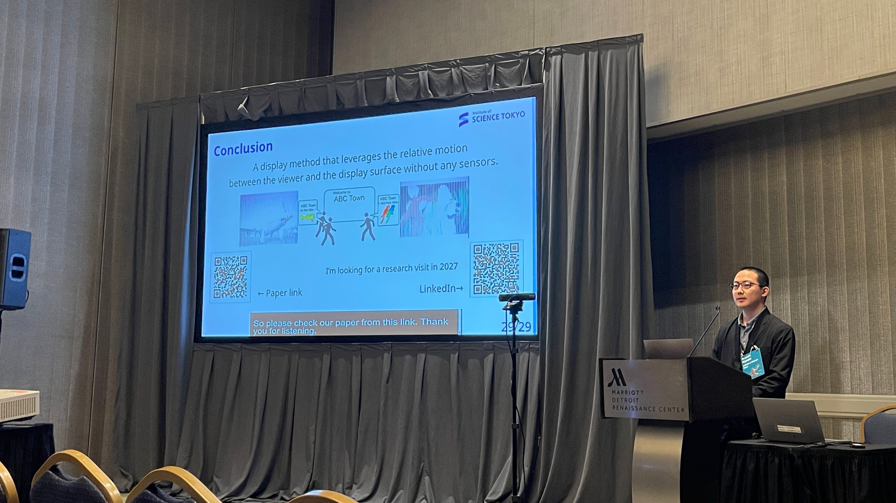

## Overview

I attended [ACM Symposium on User Interface Software and Technology](https://uist.acm.org/2026/) (UIST 2026), an international conference held in Detroit, USA, from November 2 to 5, 2026. UIST is one of the top conferences in HCI and a venue I have long admired. I submitted a full paper last year as well, but it was rejected (although my demo was accepted, so I did present the demo). This year, my paper was finally accepted and I was able to give a talk. A junior member of my lab also had a demo accepted and presented it. Congratulations!

The title of my talk was "Relative-Motion-Aware Color Presentation with High-Speed Projection". We implemented a signage system using a high-speed projector whose displayed content changes depending on the direction in which the viewer is moving. [Link to the paper](https://dl.acm.org/doi/10.1145/3830398.3830710)

## Impressions

- This was my second time attending UIST in person, and the atmosphere is still remarkable. Many professors whose names I have seen again and again in papers are there, and listening to the talks is overwhelming.
- The venue hotel seemed nice, and the restaurant and shop inside were expensive (perhaps just the local cost of living). I collapsed the day before my talk from lack of nutrition (and sleep).
- Attending UIST and other conferences, I gradually meet more acquaintances, which makes me happy.
