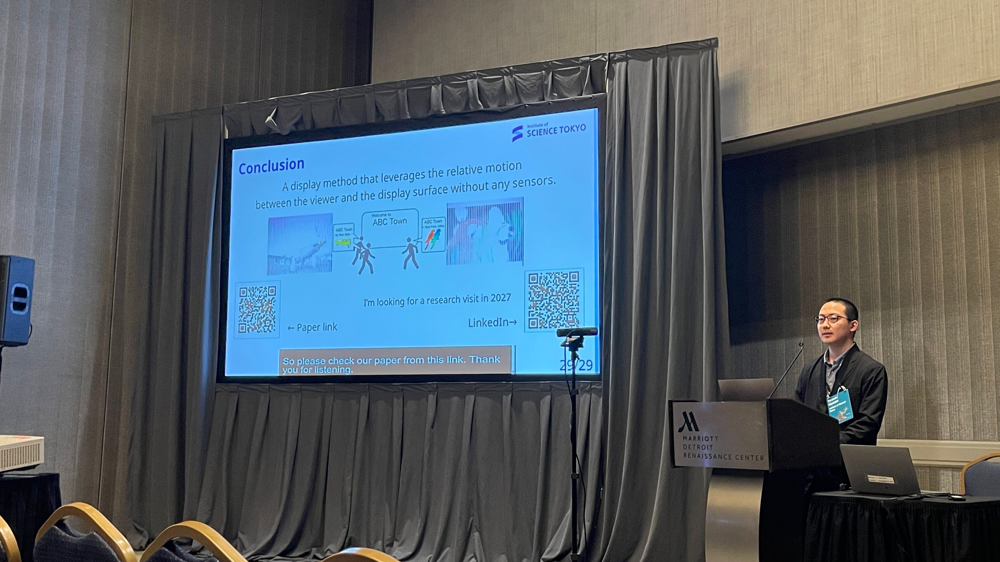

## 真面目な概要

2026/11/2~2026/11/5にアメリカ，デトロイトで行われた国際学会 [ACM Symposium on User Interface Software and Technology](https://uist.acm.org/2026/) (UIST 2026) に参加しました．UISTはHCI分野のトップカンファレンスでもあり，自身にとっても憧れの学会で，去年もフルペーパーに投稿していましたがRejectされ(デモはAcceptされたのでデモ発表はしました)，今年はついにAcceptされ登壇発表ができました．また，後輩もデモで採択され発表を行いました．おめでとう．

発表題目は"Relative-Motion-Aware Color Presentation with High-Speed Projection"．高速プロジェクタを用いて，特定の方向に移動しながら見ると表示内容が変化するサイネージを実装しています．[リンクはこちら](https://dl.acm.org/doi/10.1145/3830398.3830710)

## 感想など

- UISTの現地参加は2回目ですが，やはり雰囲気がすごい．論文で名前を何度も見た先生方がたくさん居る，発表を聞いていると圧倒される．
- 会場ホテルが良さげなホテルだっただけあって併設レストランや購買コーナーも高い(元々の物価かもしれない)．発表前日に栄養不足(と睡眠不足)で倒れた．
- UIST含め色々な学会に参加しているとだんだん知り合いが増えて嬉しい．
